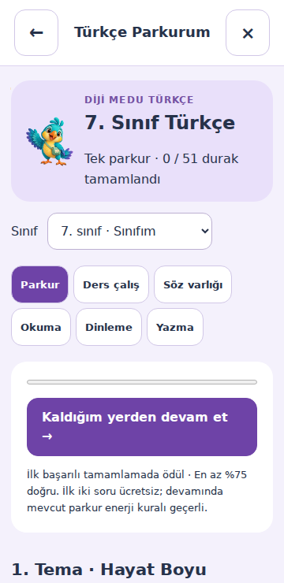
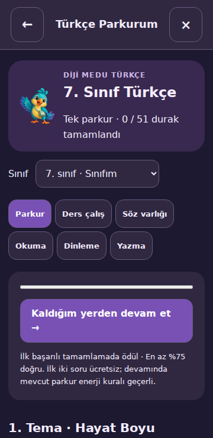
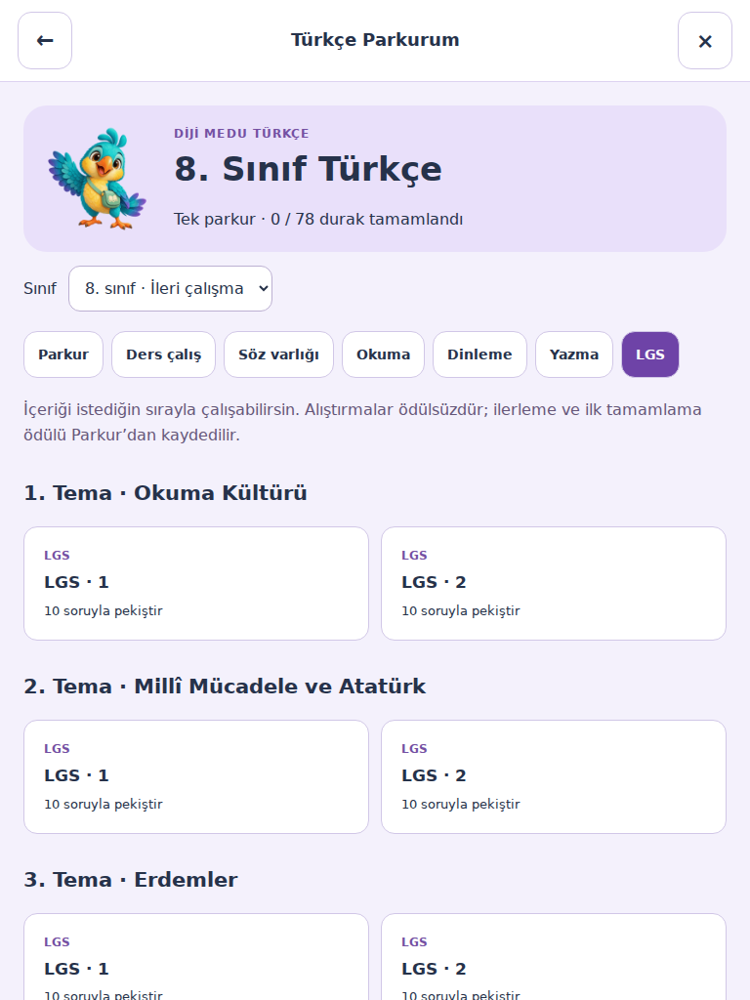

# Aşama 2 · Tek Türkçe parkuru

23 Ekim 2026. Bu dal, 8. sınıf içerik dalının üzerine kuruludur; #5 ve öncülleriyle birlikte değerlendirilmelidir. Canlı veritabanına migration uygulanmadı, Edge Function veya site yayımlanmadı. Birleştirme proje sahibindedir.

## Kullanıcı akışı

- Kayıtta öğrenci/öğretmen seçilir. Öğrenci, 5–8. sınıflardan sınıfını belirtir; yaş ve veli iletişim/onay akışı korunur. Başlangıç tercihi, CEFR seçimi ve kayıt sonrası seviye testi kaldırılmıştır.
- Profilde seviye testi ve iki parkur arasında geçiş düğmesi yoktur. Tek giriş **Türkçe Parkurum**dur. Eski seviye testi çağrıları Türkçe parkuruna yönlenir; eski sonuç gönderimleri sunucuda `410`, davetler `show:false` döner.
- Parkur öğrencinin sınıfının ilk temasından başlar. Önceki durak tamamlanmadan sonraki durak açılmaz. Başarı eşiği en az %75 doğrudur. Daha alt/üst sınıflar sırasıyla **Tekrar** / **İleri çalışma** etiketiyle incelenebilir; bu seçim hesap sınıfını değiştirmez.
- Aynı içerik kaynağından Ders çalış, Söz varlığı, Okuma, Dinleme, Yazma ve 8. sınıfta LGS bölümleri açılır. Serbest alıştırma ödülsüzdür; parkur durakları ilk başarılı tamamlamada ödüllüdür. Eski mini oyunların ayrı mekanikleri bu PR’da topluca yeniden yazılmamıştır.
- Dinleme `tr-TR` sesle çalışır; Türkçe ses yoksa açık metinle devam edilir. Yazma, yayımlanan sözcük sınırı ve rubrikle gönderilir; otomatik not/XP verilmez. Öğretmen yalnızca kendi öğrencilerinin yazılarını değerlendirir. Öğrencinin metni değişince önceki değerlendirme geçersizleşir.
- Sınıfı eksik/eski aralıkta olan hesaplar rastgele bir sınıfa atanmaz; kişisel bilgilerden 5–8. sınıf seçmeleri istenir. Demo ve öğretmen ön izlemesi ilerleme, enerji veya ödül yazmaz.

## İçerik ve üretim

| Sınıf | Tema | Parkur durağı |
| --- | ---: | ---: |
| 5 | 6 | 66 |
| 6 | 6 | 57 |
| 7 | 6 | 51 |
| 8 | 8 | 78 |

Toplam 26 tema, 252 durak. Bankadaki 1473 soru ve 780 söz varlığı girdisi çalışma akışına bağlanır. Uzun testler en fazla 12 soruluk bölümlere ayrılır; hiçbir soru atılmaz. Aynı konu birden fazla bölüme ayrılabilir; kaynak bankadaki konu sayısı 79’dur.

`node tools/turkce-paketle.mjs` kaynak tema dosyalarından tarayıcı ve sunucu paketlerini üretir. `--check` üretim farkını CI’da reddeder. Tarayıcı önce küçük dizini, sonra yalnızca açılan sınıfın paketini indirir. Paket sürümü uyuşmazsa eski soru ile yeni sonuç karıştırılmaz.

`content/turkce/durak-kimlikleri.json` ödül kimliklerinin kalıcı kaydıdır. Mevcut eşlemeler yeniden numaralandırılmamalı; silinen içeriklerin kimlikleri de tekrar kullanılmamalıdır. 290001–300000 aralığı eski 1–8. sınıf duraklarından ayrıdır; eski ödül motorunun 51–99 son ekli uyumluluk eşleme kuralına girmez.

## Kayıt, doğrulama ve ekonomi

Yeni migration yalnızca `dm_turkce_runs`, `dm_turkce_progress`, `dm_turkce_writing` tablolarını ve üç hizmet RPC’sini ekler. Önceki migration dosyaları değiştirilmemiştir. Yeni tablolarda RLS açıktır; `anon` ve `authenticated` rolleri tablo/RPC erişimi alamaz. Uygulamanın mevcut özel oturum doğrulaması ve hesap/iletişim güvenlik kontrolleri kullanılır.

Sunucu soru, sınıf, önceki durak ve ödül kimliğini bankadan alır; istemci puanı veya `correct` iddiası kullanılmaz. Çalışma ve cevaplar öğrenci kimliğine bağlıdır. SQL öğrenci/oturum kilidi altında soru sırasını, enerji adımını, ilerlemeyi ve ilk ödülü birlikte kaydeder. Aynı sorunun tekrarı ilk makbuzu döndürür. Ağ hatasında arayüz sıradaki soruya geçmez.

Mevcut enerji adımı ve ödül fonksiyonları çağrılır: parkur üst sınırı 192 XP / 40 altın, ilk iki soru ücretsiz ve mevcut doğru serisi enerji kuralı geçerlidir. En az 5. hesap seviyesinde her üçüncü Türkçe tamamlama, mevcut seviye tablosundaki durak bonusunu bir kez verir. Eski XP, altın, İngilizce tamamlamalar ve sınav kayıtları silinmez. Türkçe ilerlemesi ayrı tutulur; eski İngilizce tamamlamalar Türkçe soruları çözülmüş sayılmaz.

Çalışmalar bir saat sonra sona erer; öğrenci başına saatte 60 yeni çalışma sınırı vardır. Bir sonraki çalışma başlangıcında o öğrenciye ait bir günden uzun süredir sona ermiş oturumlar temizlenir. İlerleme ve öğretmen değerlendirmeleri kalıcıdır. Yazı okunurken geciken sunucu cevabı öğrencinin yazmaya başladığı metnin üstüne yazmaz.

## Doğrulama

- İçerik denetimi: 0 hata, 0 doğrulanmamış kaynak.
- Türkçe testleri: içerik, LGS mantığı, paket, API ve gerçek PostgreSQL motorunda yeni migration/ödül/enerji kontrolleri. `node --test tests/turkce-*.test.mjs`.
- Kayıt, Google kaydı, profil, üye araçları ve içerik kontrollerinin birlikte koşusu: **109/109 başarılı**. Türkçe grubunun kendisi 78 testtir.
- Tarayıcı: 360 px gündüz/gece, 768 px, LGS listesi, ağ hatasında yeniden gönderme, hesap değişiminde kapanma, gecikmiş yazı okumasının yeni metni koruması, gerçek uygulama açılışı ve yalnızca 5–8. sınıflı kayıtta seviye testi bulunmaması. `tarayici-sonuclari.json` ve ekran görüntüleri bu klasördedir. Gerçek hesaba yazılmamış, yerel HTTP ve API test çiftleri kullanılmıştır.
- Genel eski test takımı tamamen yeşil değildir. Son geniş koşuda 1169 testten 1138 başarılı, 29 başarısız, 2 atlanmıştı. Bunların 28’i önceki envanterde de başarısızdı; eski A1/A2 çarkının tarayıcı ölçüm testi toplu koşuda kararsız sonuç verdi, hem değişmemiş başlangıç sürümünde hem mevcut kaynakta ayrı koşuda geçti. Önceki envanterde toplam 33 hata vardı. Değiştirilen gereksinimlere ait eski testler yeni tek parkur davranışını doğrulayacak şekilde güncellenmiştir; diğer eski sorunlar bu PR’a karıştırılmamıştır.

Tarayıcı kontrolü, Playwright kurulu ortamda `node tools/turkce-tarayici-kontrol.cjs` ile çalıştırılabilir; özel kurulumda `TURKCE_PLAYWRIGHT_PATH` ve `TURKCE_CHROMIUM_PATH` değişkenleri kullanılabilir.

## Yayına hazırlık

Proje sahibi birleştirdikten sonra sıralama: yeni migration → `diji-api` Edge Function → statik dosyalar ve servis çalışanı. Kaynak paketlerin sürümleri birlikte yayımlanmalıdır. Yeni fonksiyon ve tablolar gelmeden yalnızca arayüz yayımlanmamalıdır. Geri dönüşte önceki ön yüz/fonksiyon sürümü yüklenebilir; eklenen tabloları veya eski bakiyeleri silmek gerekmez.

